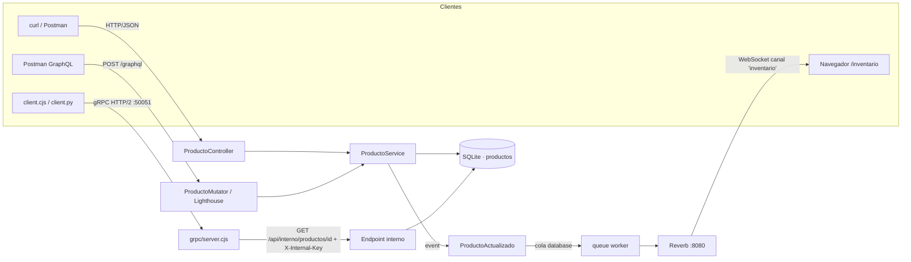

# Inventario API — REST · GraphQL · WebSockets · gRPC

API de inventario multicanal construida con **Laravel 13** que expone un mismo recurso (`Producto`) a través de cuatro estilos de comunicación:

| Canal | Tecnología | Uso típico |
|---|---|---|
| **REST** | Controlador `apiResource` | CRUD clásico sobre HTTP/JSON |
| **GraphQL** | [Lighthouse](https://lighthouse-php.com) | Consultas flexibles y mutaciones tipadas |
| **WebSockets** | [Laravel Reverb](https://reverb.laravel.com) + Echo | Notificación en tiempo real de cambios de stock |
| **gRPC** | Node.js (`@grpc/grpc-js`) + clientes Node/Python | Comunicación entre servicios con contrato Protobuf |

> Proyecto de laboratorio — **Programación IV, Tecnicatura Universitaria en Programación (UTN FRRe)**. Pensado para desarrollo local, no para producción.

---

## Tabla de contenidos

- [Arquitectura](#arquitectura)
- [Requisitos](#requisitos)
- [Instalación](#instalación)
- [Variables de entorno](#variables-de-entorno)
- [Puesta en marcha](#puesta-en-marcha)
- [Uso de cada canal](#uso-de-cada-canal)
  - [REST](#rest)
  - [GraphQL](#graphql)
  - [WebSockets (Reverb)](#websockets-reverb)
  - [gRPC](#grpc)
- [Estructura del proyecto](#estructura-del-proyecto)
- [Tests](#tests)
- [Solución de problemas](#solución-de-problemas)
- [Notas de seguridad](#notas-de-seguridad)

---

## Arquitectura

Toda la lógica de negocio vive en **`ProductoService`**. REST y GraphQL lo reutilizan, así que las validaciones y la emisión de eventos no se duplican.



**Flujo de un cambio de stock:**
1. Un cliente modifica un producto por REST (`PATCH /api/productos/{id}`) o GraphQL (`actualizarStock`).
2. `ProductoService` valida, persiste y dispara `ProductoActualizado`.
3. Como el evento implementa `ShouldBroadcast`, se encola; el *worker* lo envía a Reverb.
4. Reverb lo publica en el canal público `inventario` como `producto.actualizado`.
5. Todas las pestañas abiertas en `/inventario` lo reciben y refrescan la tabla.

---

## Requisitos

| Herramienta | Versión | Para qué |
|---|---|---|
| PHP | ≥ 8.3 (con `pdo_sqlite`) | Laravel |
| Composer | 2.x | Dependencias PHP |
| Node.js | ≥ 20.12 | Vite, Echo y servidor gRPC (usa `process.loadEnvFile`) |
| npm | 10.x | Dependencias JS |
| Python | 3.10+ *(opcional)* | Cliente gRPC en Python |

---

## Instalación

```bash
# 1. Dependencias PHP y JS
composer install
npm install

# 2. Configuración
cp .env.example .env            # PowerShell: Copy-Item .env.example .env
php artisan key:generate

# 3. Base de datos SQLite (si no existe)
php -r "file_exists('database/database.sqlite') || touch('database/database.sqlite');"

# 4. Migraciones + datos de ejemplo (3 productos y un usuario)
php artisan migrate --seed
```

Completar en `.env` los valores de `REVERB_APP_KEY`, `REVERB_APP_SECRET` y `GRPC_INTERNAL_KEY` (ver [Variables de entorno](#variables-de-entorno)).

**Cliente gRPC en Python (opcional):**

```bash
python -m pip install grpcio grpcio-tools
# Solo si se modifica producto.proto: regenerar stubs
cd grpc
python -m grpc_tools.protoc -I. --python_out=. --grpc_python_out=. producto.proto
```

---

## Variables de entorno

Variables propias del proyecto (el resto son las estándar de Laravel):

| Variable | Ejemplo | Descripción |
|---|---|---|
| `DB_CONNECTION` | `sqlite` | Base de datos (`database/database.sqlite`) |
| `QUEUE_CONNECTION` | `database` | Cola donde se encolan los eventos de broadcast |
| `BROADCAST_CONNECTION` | `reverb` | Driver de broadcasting |
| `REVERB_APP_ID` / `REVERB_APP_KEY` / `REVERB_APP_SECRET` | *aleatorios* | Credenciales de la app Reverb |
| `REVERB_HOST` / `REVERB_PORT` / `REVERB_SCHEME` | `localhost` / `8080` / `http` | Dónde escucha Reverb |
| `VITE_REVERB_*` | `"${REVERB_*}"` | Las mismas credenciales expuestas al frontend (Echo) |
| `GRPC_INTERNAL_KEY` | `clave-local-larga-de-prueba` | Clave compartida entre Laravel y `grpc/server.cjs` (header `X-Internal-Key`) |

Para generar una clave aleatoria: `php -r "echo bin2hex(random_bytes(16));"`

> Tras modificar `.env`, reiniciar los procesos. Si se usó `php artisan config:cache`, ejecutar `php artisan config:clear`.

---

## Puesta en marcha

### Opción A — un solo comando (recomendado)

```bash
composer dev
```

Levanta en paralelo los cuatro procesos de Laravel:

| Proceso | Comando | Puerto |
|---|---|---|
| Servidor web | `php artisan serve` | `8000` |
| WebSockets | `php artisan reverb:start` | `8080` |
| Worker de cola | `php artisan queue:listen` | — |
| Frontend | `npm run dev` (Vite) | `5173` |

Y en **otra terminal**, el servidor gRPC:

```bash
node grpc/server.cjs     # escucha en 127.0.0.1:50051
```

> `server.cjs` lee `GRPC_INTERNAL_KEY` directamente del `.env`; no hace falta exportarla.

### Opción B — terminales separadas

```bash
php artisan serve          # Terminal 1
php artisan reverb:start   # Terminal 2
php artisan queue:work     # Terminal 3 (ShouldBroadcast necesita la cola)
npm run dev                # Terminal 4
node grpc/server.cjs       # Terminal 5
```

---

## Uso de cada canal

> En **PowerShell**, usar `curl.exe` en lugar de `curl` (que es un alias de `Invoke-WebRequest`).

### REST

Base URL: `http://127.0.0.1:8000/api`

| Método | Ruta | Descripción | Respuesta |
|---|---|---|---|
| `GET` | `/productos` | Lista todos los productos | `200` |
| `POST` | `/productos` | Crea un producto | `201` · `422` si es inválido |
| `GET` | `/productos/{id}` | Obtiene un producto | `200` · `404` |
| `PUT/PATCH` | `/productos/{id}` | Actualiza campos (parcial) | `200` · `404` · `422` |
| `DELETE` | `/productos/{id}` | Elimina un producto | `204` · `404` |
| `GET` | `/interno/productos/{id}` | Endpoint interno para gRPC (requiere `X-Internal-Key`) | `200` · `403` · `404` |

**Reglas de validación:** `nombre` string ≤ 100 · `precio` numérico ≥ 0 · `stock` entero ≥ 0.

```bash
# Listar
curl -i http://127.0.0.1:8000/api/productos

# Crear
curl -i -X POST http://127.0.0.1:8000/api/productos \
  -H 'Accept: application/json' -H 'Content-Type: application/json' \
  -d '{"nombre": "Teclado", "precio": 25000, "stock": 12}'

# Actualizar stock
curl -i -X PATCH http://127.0.0.1:8000/api/productos/1 \
  -H 'Accept: application/json' -H 'Content-Type: application/json' \
  -d '{"stock": 11}'

# Eliminar
curl -i -X DELETE http://127.0.0.1:8000/api/productos/1
```

Ejemplo de respuesta:

```json
{
  "id": 1,
  "nombre": "Teclado",
  "precio": "25000.00",
  "stock": 12,
  "created_at": "2026-10-29T03:32:52.000000Z",
  "updated_at": "2026-10-29T03:32:52.000000Z"
}
```

### GraphQL

Endpoint: `POST http://127.0.0.1:8000/graphql` — esquema en [`graphql/schema.graphql`](graphql/schema.graphql).

```graphql
# Consultas
{ productos { id nombre precio stock } }
{ producto(id: 1) { id nombre stock } }

# Mutaciones
mutation { crearProducto(nombre: "Mouse", precio: 18000, stock: 20) { id nombre stock } }
mutation { actualizarStock(id: 1, stock: 8) { id stock } }
```

Con curl (body JSON):

```bash
curl -X POST http://127.0.0.1:8000/graphql \
  -H 'Content-Type: application/json' \
  -d '{"query":"{ productos { id nombre precio stock } }"}'
```

> En Postman se puede elegir **Body → GraphQL** y pegar la operación sin escapar comillas. Los errores GraphQL pueden volver con HTTP `200` y un campo `errors`: revisar ambos.

### WebSockets (Reverb)

1. Con `composer dev` corriendo, abrir **http://127.0.0.1:8000/inventario** en dos pestañas.
2. Pulsar **+1 stock** en una de ellas.
3. La otra pestaña recibe el evento por WebSocket y se actualiza sola; el log inferior muestra el *payload*.

| Dato | Valor |
|---|---|
| Canal | `inventario` (público) |
| Evento | `producto.actualizado` |
| Se emite al | crear o actualizar un producto (REST o GraphQL) |

Payload:

```json
{
  "producto": { "id": 1, "nombre": "Teclado", "precio": "25000.00", "stock": 13 },
  "accion": "actualizado"
}
```

Suscripción desde JavaScript (ya incluida en `resources/js/app.js`):

```js
window.Echo.channel('inventario')
    .listen('.producto.actualizado', (evento) => console.log(evento));
```

### gRPC

Contrato: [`grpc/producto.proto`](grpc/producto.proto)

```protobuf
service ProductoService {
  rpc ObtenerProducto (ProductoRequest) returns (ProductoResponse);
}
```

El servidor Node (`grpc/server.cjs`) recibe la llamada, consulta el endpoint interno de Laravel con la clave compartida y traduce la respuesta a Protobuf.

```bash
# Cliente Node (el id es opcional, por defecto 1)
node grpc/client.cjs 1

# Cliente Python
cd grpc
python client.py 1
```

Salida esperada:

```
{ id: 1, nombre: 'Teclado mecánico', precio: 25000, stock: 12 }
```

| Situación | Código gRPC |
|---|---|
| Producto existente | `OK` |
| ID inexistente | `NOT_FOUND` |
| Laravel responde error (p. ej. `403` por clave inválida) | `INTERNAL` |
| Laravel no está levantado | `UNAVAILABLE` |

---

## Estructura del proyecto

```
inventario-api/
├── app/
│   ├── Events/ProductoActualizado.php          # Evento broadcast (canal 'inventario')
│   ├── GraphQL/Mutations/ProductoMutator.php   # Resolvers de mutaciones GraphQL
│   ├── Http/
│   │   ├── Controllers/Api/ProductoController.php  # CRUD REST
│   │   └── Middleware/ValidateInternalKey.php      # Protege /api/interno/*
│   ├── Models/Producto.php
│   └── Services/ProductoService.php            # Lógica de negocio compartida
├── config/services.php                         # services.grpc.internal_key
├── database/
│   ├── migrations/…_create_productos_table.php
│   └── seeders/ProductoSeeder.php              # Datos de ejemplo
├── graphql/schema.graphql                      # Esquema Lighthouse
├── grpc/
│   ├── producto.proto                          # Contrato Protobuf
│   ├── server.cjs                              # Servidor gRPC (Node.js)
│   ├── client.cjs                              # Cliente Node
│   ├── client.py                               # Cliente Python
│   └── producto_pb2*.py                        # Stubs Python generados
├── resources/
│   ├── js/app.js, echo.js                      # Suscripción Echo/Reverb
│   └── views/inventario.blade.php              # Demo en tiempo real
└── routes/
    ├── api.php                                 # REST + endpoint interno
    └── web.php                                 # /inventario
```

---

## Tests

```bash
composer test        # o: php artisan test
```

---

## Solución de problemas

| Síntoma | Causa probable / solución |
|---|---|
| La segunda pestaña de `/inventario` no se actualiza | Falta el *worker* de cola (`queue:listen`/`queue:work`) o Reverb no está corriendo. Revisar la consola del navegador. |
| `Application does not exist` (4001) en la consola | `VITE_REVERB_APP_KEY` no coincide con `REVERB_APP_KEY`. Reiniciar `npm run dev` tras cambiar `.env`. |
| Jobs en `failed_jobs` | Ver el detalle con `php artisan queue:failed`; reintentar con `queue:retry all` o limpiar con `queue:flush`. |
| gRPC devuelve `NOT_FOUND` | El ID no existe; listar los productos con `GET /api/productos` y pasar un ID válido al cliente. |
| gRPC devuelve `INTERNAL ... 403` | `GRPC_INTERNAL_KEY` vacía o distinta; reiniciar `php artisan serve` y `server.cjs`. |
| gRPC devuelve `UNAVAILABLE` | Laravel no está levantado en `127.0.0.1:8000`. |
| `ModuleNotFoundError: No module named 'grpc'` | `python -m pip install grpcio grpcio-tools`. |
| Acentos mal mostrados en el cliente Python (Windows) | Ejecutar con `python -X utf8 client.py` o `chcp 65001`. |
| `curl` en PowerShell da errores de parámetros | Usar `curl.exe`. |

---

## Notas de seguridad

Este proyecto es un laboratorio. Antes de llevarlo a producción:

- **Autenticar** las rutas REST/GraphQL (Laravel Sanctum ya está instalado).
- Usar **canales privados** en lugar del canal público `inventario`.
- Proteger gRPC con **TLS** y no exponer el puerto `50051` públicamente.
- Reemplazar la clave compartida por autenticación robusta entre servicios.
- Para descontar stock de forma concurrente, usar **transacciones con bloqueo de filas** o actualizaciones atómicas (el ejemplo asigna un valor absoluto).
- En la vista demo, construir el DOM con `textContent` en lugar de interpolar datos en `innerHTML`.

---

## Licencia

Proyecto académico basado en el esqueleto de Laravel (licencia [MIT](https://opensource.org/licenses/MIT)).
